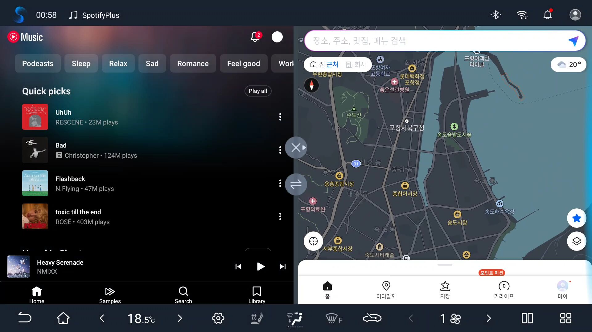
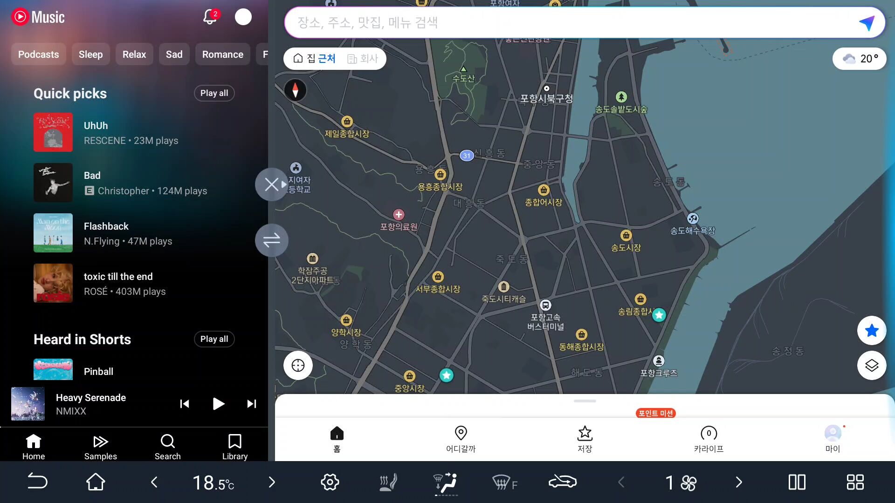
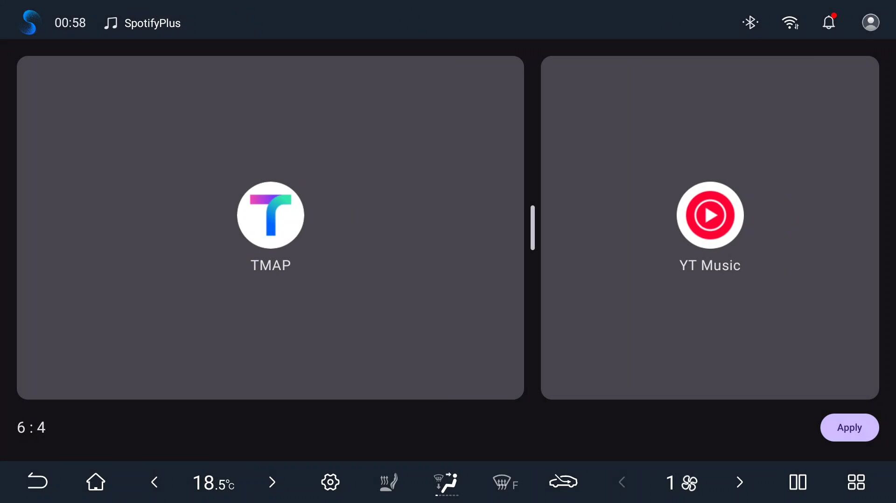
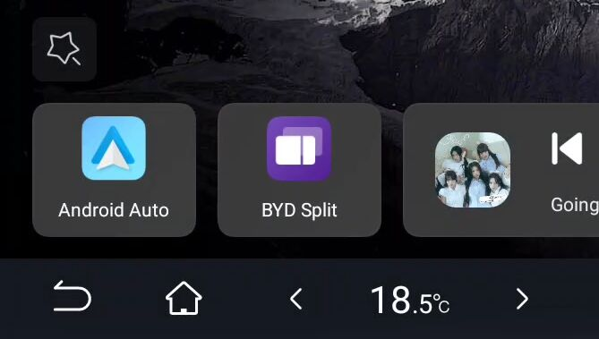
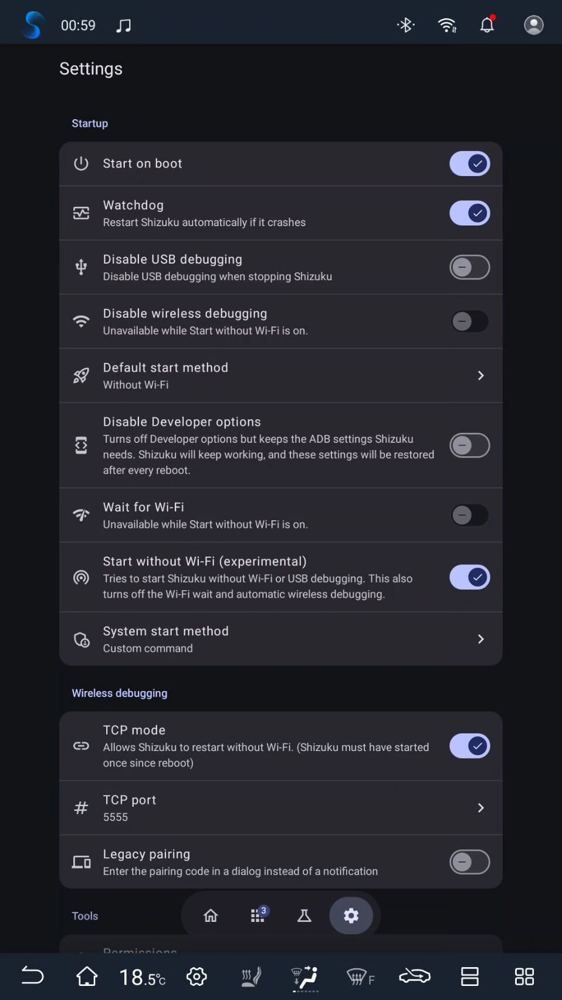

# BYD Split

[English](README.md) | **한국어**

BYD Split은 BYD 헤드유닛에서 두 앱을 정해진 비율(예: 7:3)의 화면 분할로 한 번에 띄워 줍니다. 왼쪽에는 내비게이션을 크게, 오른쪽에는 음악 앱을 둘 수 있습니다. 상단 상태 표시줄도 숨겨 화면을 최대한 넓게 씁니다.

[Shizuku](https://github.com/rushiranpise/Shizuku-Next)가 필요합니다.

## 스크린샷

적용 전:



적용 후:



설정:



홈 화면 바로가기:



권장 Shizuku 설정:



## 기능

- 왼쪽과 오른쪽 창에 원하는 앱을 각각 선택
- 구분선을 드래그해 비율 설정 (2:8부터 8:2까지 단계별로 맞춰짐)
- 화면 분할 중에는 상태 표시줄을 숨겨(`wm overscan`) 화면을 더 넓게 사용
- 다른 앱이나 홈 화면으로 이동하면 상태 표시줄을 자동으로 복원

## 요구 사항

- Android 10 기반 BYD 헤드유닛
- 실행 중인 [Shizuku](https://github.com/rushiranpise/Shizuku-Next)
  - 부팅 시 자동으로 시작할 수 있는 [Shizuku-Next](https://github.com/rushiranpise/Shizuku-Next) 포크를 권장합니다

## 다운로드

최신 APK는 [Releases](https://github.com/arter97/BYDSplit/releases/latest)에서 받을 수 있습니다.

## 사용 방법

1. Shizuku를 설치하고 실행합니다.
2. BYD Split을 엽니다.
3. 왼쪽 칸을 눌러 앱을 고르고, 오른쪽 칸도 같은 방법으로 고릅니다.
4. 구분선을 드래그해 원하는 비율로 맞춥니다.
5. **적용**을 누르고, Shizuku 권한 요청이 뜨면 허용합니다.

이후에는 BYD Split을 실행하면 바로 화면이 분할됩니다.
앱이나 비율을 바꾸려면 앱 아이콘을 길게 눌러 나오는 **설정** 바로가기를 사용하거나 앱을 재설치하세요.

## 동작 방식

1. 두 앱을 실행합니다.
2. 왼쪽 앱은 화면 분할 기본(primary) 창으로, 오른쪽 앱은 보조(secondary) 창으로 옮깁니다.
3. `am stack resize`로 두 스택을 선택한 비율에 맞게 조절합니다.
4. `wm overscan`으로 상태 표시줄을 숨깁니다.
5. 포그라운드 서비스가 태스크 스택 리스너를 등록합니다. 두 앱 외의 다른 앱이 포그라운드로 오면 `wm overscan reset`을 실행하고 서비스를 종료합니다.

## 빌드

```sh
./gradlew assembleRelease
```

## 라이선스

Copyright 2026 Juhyung Park (arter97) <qkrwngud825@gmail.com>

[Apache License, Version 2.0](LICENSE)에 따라 배포됩니다.
